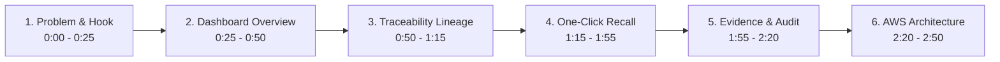

# BatchGuard — Final Video Production Plan (< 3 Minutes)

**Challenge:** AWS Builder Center Weekend Challenge — *No Pipeline, No Problem*  
**Platform Target:** AWS Builder Center (`builder.aws.com`)  
**Target Video Duration:** **2 minutes 50 seconds** (Strictly under the 3-minute challenge guideline)  
**Resolution:** 1920 × 1080 (1080p, 60 FPS recommended)  
**Target URL:** [https://batchguard-pi.vercel.app/dashboard](https://batchguard-pi.vercel.app/dashboard)  
**Operating Mode:** Demonstration Mode (`DEMO MODE` active with in-browser mock engine)  

> [!IMPORTANT]
> **Strict Demonstration Disclosure:**  
> All presenter narration must clearly identify that the live public frontend runs in **DEMO MODE** with simulated data engines, while the complete AWS serverless backend (20 Lambdas, Step Functions, DynamoDB, S3) is fully implemented and validated in the open-source repository.

---

## 1. Scene-by-Scene Production Script & Timestamps

---

### Scene 1: Opening Hook & Problem Statement (0:00 – 0:25)
* **Screen / Route:** Browser on `/dashboard` (full window).
* **Presenter Action:** Cursor sweeps smoothly across the header, pausing over the logo and tagline: *"One Batch. Complete Traceability. Faster Recalls."*
* **Spoken Narration (Word-for-Word):**
  > *"Every year, foodborne pathogens sicken 48 million Americans. When Salmonella or Listeria strikes, traditional supply chains face a deadly bottleneck: tracing contaminated ingredient lots across multi-tier networks takes 6 to 14 days of phone calls and paper manifests. In that window, tainted food stays on shelves, while panicked companies issue over-broad nationwide recalls that destroy millions of dollars in safe food. Today, we're demonstrating BatchGuard."*
* **Visual Cue:** Highlight header tagline.

---

### Scene 2: Operations Dashboard & Live Telemetry (0:25 – 0:50)
* **Screen / Route:** `/dashboard`
* **Presenter Action:** Hover across the 4 KPI cards (12,482 Active Lots, 4,821 Monitored Nodes, 48.2m Containment Velocity) and hover over the cold-chain temperature telemetry chart. Highlight the amber **`DEMO MODE`** badge in the header.
* **Spoken Narration:**
  > *"Here on the executive dashboard, food safety officers monitor nationwide operational health in real time. Notice the amber 'DEMO MODE' indicator in our header—accurately informing evaluators that this public web application runs in-browser with simulated supply chain data. Across the country, cold-chain temperature telemetry curves track active pallet transit to detect thermal abuse before food ever reaches consumers."*
* **Visual Cue:** Point cursor directly to the amber `DEMO MODE` badge.

---

### Scene 3: Bidirectional Batch Traceability & KDE Score (0:50 – 1:15)
* **Screen / Route:** Click **Batch Registry** in sidebar (`/batches`), then click **Lineage** button on lot `BG-2024-8891-ORG` (`/batches/BG-2024-8891-ORG`).
* **Presenter Action:** Scroll through the backward provenance and forward transit hops; hover over the 98.4% KDE Traceability Confidence Score. Click **Print GS1-128 Placard**.
* **Spoken Narration:**
  > *"On the Batch Details screen, BatchGuard delivers instantaneous bidirectional provenance. Tracing backward, we track this spinach lot directly to Salinas Valley Organics, Field 4B, harvested on October 28th. Tracing forward, we monitor warehouse arrivals and carrier line-hauls. Our engine calculates an automated 98.4% KDE traceability score, and generates standard GS1-128 pallet placards in a single click."*
* **Visual Cue:** Placard toast pops up in the bottom right corner.

---

### Scene 4: One-Click Recall Orchestration & Blast-Radius Analysis (1:15 – 1:55)
* **Screen / Route:** Click **Recall Management** (`/recalls`).
* **Presenter Action:**
  1. Click **+ Initiate Targeted Recall**.
  2. Step 1: Select batch `BG-2024-8891-ORG`, click **Proceed to Step 2**.
  3. Step 2: Select **Class I Critical** hazard card, click **Proceed to Step 3**.
  4. Step 3 (Blast Radius): Hover over the 3 affected facilities and 18,450 units. Click **Proceed to Step 4**.
  5. Step 4 (Authorization): Type phrase `CONFIRM-RECALL-BG-2024-8891-ORG`, enter demo 2FA token `123456`, click **Broadcast Emergency Recall**.
* **Spoken Narration:**
  > *"Now, let's trigger BatchGuard's signature capability: One-Click Recall Orchestration. Imagine our quality lab detects Listeria cross-contact. In Step 1, we select the lot. In Step 2, we classify this as FDA Class I Critical. In Step 3, BatchGuard automatically traverses the downstream distribution graph in under 2 seconds—pinpointing 18,450 units across 2 distribution centers and 42 retail stores, while intercepting 4 trucks en route. In Step 4, we enforce two-factor authentication before broadcasting. In demo mode, this simulates our AWS Step Functions orchestration workflow."*
* **Visual Cue:** Active recall banner transitions to "RECALL ACTIVE — CONTAINMENT IN PROGRESS".

---

### Scene 5: Evidence Vault & Cryptographic Audit Ledger (1:55 – 2:20)
* **Screen / Route:** Click **Evidence Vault** (`/evidence`), then click **Audit Logs** (`/audit-logs`).
* **Presenter Action:** 
  1. On Evidence Vault, highlight Certificate of Analysis (COA) entry and pre-signed download action.
  2. Switch to Audit Logs: highlight Genesis Block (`0x0000...`), click **Verify Chain Integrity**, then click **Export Safety Audit (CSV)**.
* **Spoken Narration:**
  > *"In the Evidence Vault, lab certificates and inspection photos upload directly to Amazon S3 via pre-signed URLs—bypassing compute overhead. Every critical action is committed to an append-only, content-addressable SHA-256 hash chain. When we click 'Verify Chain Integrity', the engine cryptographically validates the entire ledger from the Genesis block forward, guaranteeing tamper-proof audit defense for FDA or USDA audits."*
* **Visual Cue:** Green "Chain Integrity Verified: 100% Valid" pill illuminates; CSV downloads.

---

### Scene 6: AWS Serverless Architecture & Closing (2:20 – 2:50)
* **Screen / Route:** Switch to GitHub repository architecture diagram (`README.md` or `docs/architecture.md`).
* **Presenter Action:** Highlight the serverless components in the diagram.
* **Spoken Narration:**
  > *"Under the hood, BatchGuard is built for the AWS 'No Pipeline, No Problem' philosophy: 100% serverless with zero servers to manage. Our open-source repository provides an AWS SAM template specifying 20 Python 3.12 Lambdas, a Step Functions Standard Workflow with human task tokens, a DynamoDB single-table schema, and an S3 evidence vault. 108 backend tests and 32 Playwright browser tests pass with 100% success. While our dev cloud account was bounded by organizational security policies, the infrastructure code is complete, verified, and ready for deployment into any standard AWS account. Thank you from the BatchGuard team."*
* **Visual Cue:** Hold on the repository URL and tagline. Video concludes at 2:50.

---

## 2. Technical Production Standards

| Dimension | Specification | Notes |
| :--- | :--- | :--- |
| **Duration Target** | **2 minutes 45 seconds to 2 minutes 55 seconds** | Under the 3:00 Builder Center threshold |
| **Resolution** | 1920 × 1080 (1080p, 16:9 ratio) | Full desktop capture, hide browser bookmarks bar |
| **Video Encoding** | MP4 container, H.264 codec, 60 FPS, ~8–12 Mbps | Crystal-clear text rendering |
| **Audio Encoding** | AAC, 48 kHz, Stereo, 320 kbps | Clean voice, no clipping or echoes |
| **Hosting Options** | YouTube (Unlisted), Loom, or Vimeo | Direct link to embed in Builder Center article |

