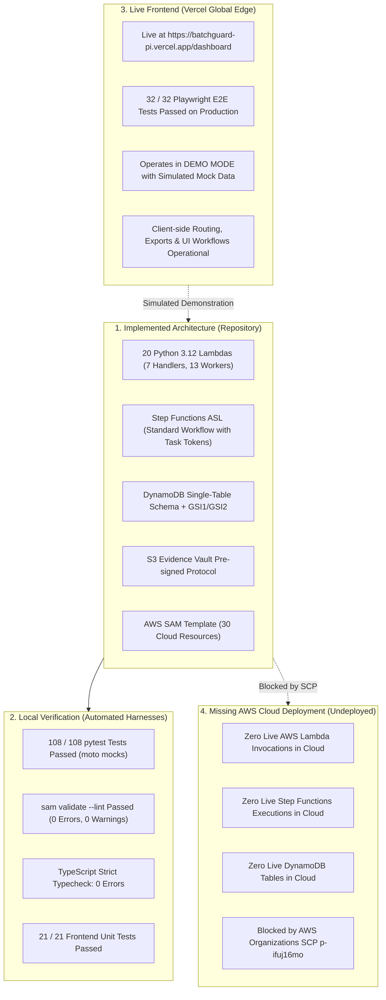

# BatchGuard — AWS Weekend Challenge Submission Audit Report

**Challenge:** AWS Weekend Challenge — *No Pipeline, No Problem*  
**Evaluation Date:** November 7, 2026  
**Auditor Roles:** Senior QA Engineer, AWS Solutions Architect, Hackathon Submission Reviewer  
**Repository:** [https://github.com/ASingha165/BATCHGUARD](https://github.com/ASingha165/BATCHGUARD)  
**Live Production Demonstration:** [https://batchguard-pi.vercel.app/dashboard](https://batchguard-pi.vercel.app/dashboard)  

---

## 1. Executive Summary

This audit assesses the submission posture of **BatchGuard** for the upcoming **AWS Weekend Challenge — "No Pipeline, No Problem"** (scheduled for November 13, 2026, 12:00 AM PT through November 16, 2026, 1:00 PM PT).

To maintain technical veracity, this audit explicitly avoids claiming that all challenge requirements are fulfilled. Instead, it clearly delineates between:
1. **Implemented Architecture:** The complete serverless backend code and SAM specification present in the repository.
2. **Local Verification:** Automated test suites and linting passing 100% in local test harnesses.
3. **Live Frontend Functionality:** The interactive demonstration deployed and operational on Vercel edge infrastructure.
4. **Missing AWS Cloud Deployment:** The un-deployed state of the AWS backend compute, storage, and orchestration resources due to account-level policy blocks.

---

## 2. Four-Quadrant Architecture & Verification Status

### Quadrant 1: Implemented Serverless Architecture (Source Code Complete)
* **AWS SAM Specification:** `template.yaml` specifies 30 infrastructure resources (API Gateway, DynamoDB, S3, SNS, Cognito, Step Functions, CloudWatch, and 20 Lambdas).
* **Lambda Compute:** 20 modular Python 3.12 ARM64 functions organized into 7 API Gateway handlers (`backend/handlers/`) and 13 Step Functions task workers (`backend/workers/`).
* **Step Functions State Machine:** Standard Workflow ASL (`statemachine/recall_orchestrator.asl.json`) implementing the `.waitForTaskToken` human approval gate, 24-hour timeout bounds, and automated retry policies.
* **Storage & Encryption:** DynamoDB single-table schema with atomic locks (`TransactWriteItems`), and S3 Evidence Vault with pre-signed PUT/GET URLs and SSE-S3 encryption.

### Quadrant 2: Local Verification & Code Validation (100% Passed)
* **Backend pytest Suite:** 108 passed tests in 1.36s covering backward BFS traversal, circular reference detection, KDE confidence math, cryptographic SHA-256 hash chains, and atomic mutex locking.
* **SAM CLI Linting:** `sam validate --lint` passed with zero errors and zero warnings.
* **Frontend TypeScript:** `tsc --noEmit` passed with zero compilation errors.
* **Frontend Unit Tests:** 21 passed unit tests in 78ms covering API URL normalization, JWT decoding, MFA challenge parsing, and CloudFront SPA router rewrite rules.

### Quadrant 3: Live Frontend Functionality (Operational on Vercel)
* **Production URL:** [https://batchguard-pi.vercel.app/dashboard](https://batchguard-pi.vercel.app/dashboard) (HTTP 200 OK across all routes).
* **Browser Automation Suite:** 32 passed Playwright tests in 55.9s testing smoke, navigation, batch registration, lineage exploration, recall simulation, and security boundaries against the live public URL.
* **Operating Mode:** Operates strictly in **DEMO MODE** (`FORCE_MOCK = true`). It does not invoke live AWS cloud endpoints. All data mutations update local in-memory state.

### Quadrant 4: Missing AWS Cloud Deployment (Undeployed)
* **Cloud Status:** No live AWS backend infrastructure is active in AWS account `316636858874`.
* **Root Cause:** Upstream AWS Organizations Service Control Policy (`p-ifuj16mo` enforced by management account `765578795131`) explicitly denies:
  * `cloudformation:CreateStack`, `cloudformation:UpdateStack`
  * `lambda:CreateFunction`
  * `dynamodb:CreateTable`
  * `apigateway:POST`
  * `states:CreateStateMachine`
  * `s3:CreateBucket`
  * `sns:CreateTopic`
  * `cognito-idp:CreateUserPool`
* **Evaluation Implication:** If the hackathon judging requires evaluators to test live AWS API Gateway invoke URLs or inspect live Step Functions executions in the AWS Management Console, the project cannot satisfy that requirement in this account.

---

## 3. Unverified Eligibility & Competition Policy Risks

> [!WARNING]
> **Pre-Existing Project & Challenge Window Constraints:**
> 1. **Challenge Schedule Window:** The competition runs from **November 13, 2026, 12:00 AM PT through November 16, 2026, 1:00 PM PT**. The current audit date is **November 7, 2026** (6 days prior to the start).
> 2. **Pre-Built Code Eligibility:** Many AWS and Devpost hackathons mandate that substantial code development must occur during the official challenge window, or require explicit disclosure if building on top of pre-existing work.
> 3. **Action Required:** The submitter must verify the official rules for the *No Pipeline, No Problem* challenge regarding:
>    * Whether projects started before November 13 are eligible for entry.
>    * Whether the submission should be entered under an "Open Project" or "Existing Project" category.
>    * Whether a dedicated hackathon branch or new feature commit within the window is required.

---

## 4. Demonstration Asset Audit

* **Screenshots (Complete):** 10 high-resolution desktop screenshots captured from production and stored in `docs/evidence/` with no credentials or sensitive data.
* **Demonstration Script (Complete):** Timed 4m 15s presenter script in `docs/DEMO_SCRIPT.md` with explicit DEMO MODE disclosures.
* **Recording Checklist (Complete):** Step-by-step checklist in `docs/VIDEO_RECORDING_CHECKLIST.md` using demonstration-only credentials.
* **Video Recording (Missing Asset):** A hosted video walkthrough URL (YouTube, Vimeo, or Loom) has not yet been recorded.

---

## 5. Misleading Claims Audit (Verified & Remediated)

The documentation has been reviewed and corrected:
* **UI Region Labels:** Clarified that the live frontend displays the amber **`DEMO MODE`** badge rather than a live `US-EAST PROD` AWS region badge.
* **Cost Disclosures:** Removed absolute statements such as "zero cost" or "zero idle cost", replacing them with standard pay-per-use on-demand serverless terminology.
* **Deployment Disclosures:** Removed claims of "guaranteed deployment within minutes", stating instead that the SAM template is valid and ready for deployment to any standard, unrestricted AWS account.
* **Regulatory Framing:** All FSMA 204 and GS1 references are framed as *alignment tools and engineering frameworks*, explicitly disclaiming certified regulatory approval.
* **Cryptographic Framing:** The audit ledger is accurately identified as an *append-only SHA-256 content-addressable hash chain*, avoiding claims of hardware HSM or PKI digital signatures.
* **Lambda Function Inventory:** Re-verified exact count in `template.yaml` as **20 Lambda functions** (7 API handlers and 13 Step Functions task workers).

---

## 6. Submission Readiness Summary

| Dimension | Readiness Status | Details |
| :--- | :---: | :--- |
| **Serverless Architecture** | **Complete** | 20 Python Lambdas, Step Functions ASL, DynamoDB single-table schema, and SAM template ready. |
| **Verification & Testing** | **Complete** | 161 total automated tests passing (32 Playwright E2E + 21 frontend unit + 108 backend pytest). |
| **Live Frontend Demo** | **Operational** | Vercel SPA live at `https://batchguard-pi.vercel.app/dashboard` in DEMO MODE. |
| **Technical Documentation** | **Complete** | Architecture specification, demo script, recording checklist, and technical evidence ready. |
| **AWS Cloud Provisioning** | **Blocked** | Blocked by organizational SCP `p-ifuj16mo`; disclosed transparently across documentation. |
| **Demonstration Video** | **Pending** | Recording checklist and script are ready; video walkthrough remains to be filmed and linked. |
| **Challenge Eligibility** | **Pending Verification** | Submitter must confirm hackathon rules regarding pre-existing code and challenge window dates. |
