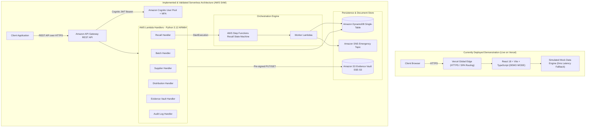
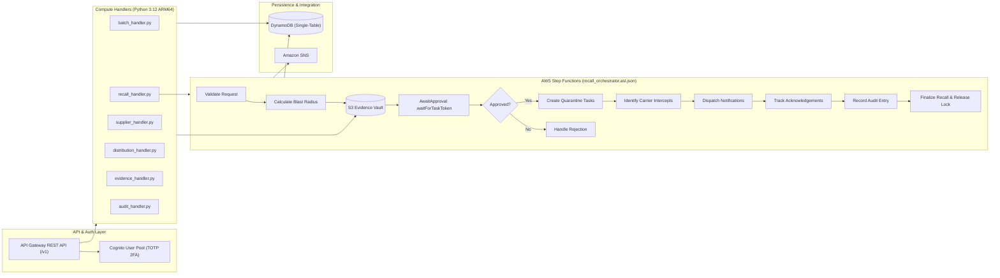
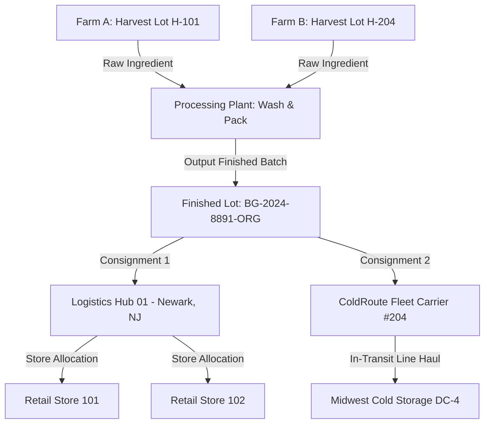
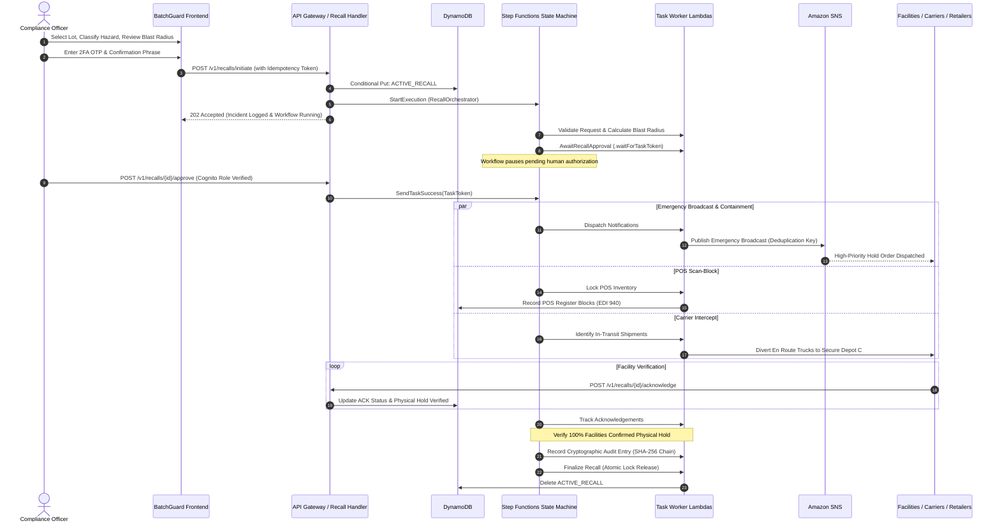
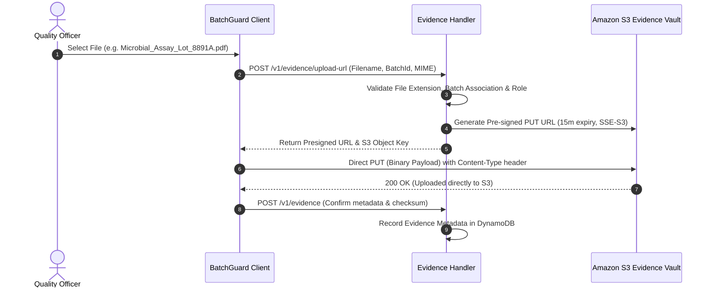
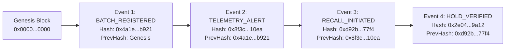

# BatchGuard — System Architecture Specification

> **Target Architecture:** Event-Driven Serverless on AWS  
> **Demonstration Architecture:** Single-Page Application (SPA) on Vercel (Demo Mode)  
> **Repository:** `https://github.com/ASingha165/BATCHGUARD`  
> **Master Directives:** [`AGENTS.md`](../AGENTS.md)

---

## 1. System Overview

**BatchGuard** is an event-driven food supply-chain traceability and recall intelligence platform. It provides end-to-end chain-of-custody tracking, critical tracking event (CTE) capture, cold-chain telemetry visibility, and signature **One-Click Recall Orchestration** for food manufacturers, growers, distribution centers (DCs), and retail operators.

### Core Problems Solved:
1. **Recall Latency:** Traditional food recalls average 3 to 14 days to identify affected facilities, allowing contaminated lots to reach consumer hands. BatchGuard models blast radius in under 2 seconds.
2. **Traceability Disconnects:** Upstream ingredient lots are frequently disconnected from downstream distribution nodes. BatchGuard links raw harvests to finished lots via directed acyclic genealogy graphs.
3. **Execution Gaps:** Facilities receive disjointed email or telephone alerts. BatchGuard coordinates automated hold orders (`EDI 940` equivalent), POS register scan-blocks, in-transit truck diversions, and facility quarantine tracking.
4. **Audit Integrity:** Regulatory scrutiny requires verifiable chain of custody. BatchGuard commits every critical tracking event and recall action to an append-only, content-addressable SHA-256 hash chain.

---

## 2. Dual Deployment Architecture: Demonstrated vs. Production

> [!IMPORTANT]
> * **Live Demonstration:** The frontend is publicly accessible at [https://batchguard-pi.vercel.app/dashboard](https://batchguard-pi.vercel.app/dashboard) in **DEMO MODE**. It runs 100% in-browser with zero active cloud dependencies.
> * **AWS Backend Readiness:** The full AWS serverless backend is implemented in `backend/` and `template.yaml`, verified by 108 pytest test cases and SAM linting, but is not provisioned on AWS due to an organizational Service Control Policy (SCP `p-ifuj16mo`) restricting resource creation.

---

## 3. Frontend Architecture

The frontend is constructed using React 18, TypeScript, and Vite, strictly following Google Stitch design tokens:

* **Design Palette:** Deep Forest Green (`#14532D`), Emerald (`#10B981`), Amber Warning (`#F59E0B`), and Critical Alert (`#DC2626`).
* **Typography:** `Inter` for interface copy, `JetBrains Mono` for lot numbers, GTINs, hashes, and timestamps, with tabular figures (`tnum`) for KPIs.
* **Layout Structure:** Fixed 260px operational side rail with responsive collapsing, sticky top header with global search, notifications drawer, and persistent `DEMO MODE` pill.
* **State & Data Ingress:** Clean typed service layer (`frontend/src/services/api.ts`). When `VITE_API_BASE_URL` is unconfigured, the client immediately switches to the in-memory mock engine (`frontend/src/services/mockData.ts`), ensuring 0ms latency with zero failing external HTTP requests.

---

## 4. AWS Serverless Backend Architecture

The implemented backend follows an event-driven serverless architecture defined in [`template.yaml`](../template.yaml):

### Serverless Component Breakdown:
1. **Amazon API Gateway:** Exposes 16 RESTful routes across batches, recalls, suppliers, logistics, evidence, and audit logs with CORS configuration and Cognito JWT authorizers.
2. **AWS Lambda (Python 3.12 ARM64):** 20 modular functions defined in `template.yaml`, divided into 7 HTTP API handlers (`backend/handlers/`) and 13 Step Functions task workers (`backend/workers/`).
3. **Amazon DynamoDB (Single-Table):** Houses all application entities with Partition Key (`PK`), Sort Key (`SK`), and two Global Secondary Indexes (`GSI1`, `GSI2`) supporting sub-10ms queries.
4. **AWS Step Functions Standard Workflow:** Coordinates multi-stage recall containment with human approval gates, bounded retries, and atomic lock release.
5. **Amazon S3 Evidence Vault:** Encrypted compliance store (`SSE-S3` AES-256) using short-lived (15-minute) pre-signed PUT and GET URLs.
6. **Amazon SNS:** High-priority fan-out alert topic dispatching emergency hold notices to facility managers and dispatchers.

---

## 5. Traceability Engine & Lineage Traversal

The traceability engine (`backend/services/traceability_service.py`) operates under strict mathematical and supply-chain invariants:

### Algorithmic Invariants:
1. **Backward Lineage Traversal (BFS):**
   * Explores upstream parent ingredient lots up to a maximum depth of 10 levels.
   * Circular ancestor references are detected via path tracking, flagged (`cycleDetected=True`), recorded as an audit warning, and safely severed to prevent infinite execution.
2. **Forward Tracking & Blast Radius Isolation:**
   * Downstream consignments are traversed from manufacturer to transit carriers, distribution centers, and retail endpoints.
   * Multiple shipments to the same physical facility are deduplicated into an aggregated node record with total units allocated.
   * Missing, unconfirmed, or in-transit stock is never assumed to be zero; discrepancies are reported as `unconfirmedUnits`.
3. **KDE Traceability Completeness Scoring:**
   * Evaluated across 6 weighted dimensions: Origin & Harvest (20%), Supplier Verification (15%), Lab Evidence (20%), Chain of Custody (15%), Delivery Timestamps (15%), and Inventory Balance (15%).
   * Categorized into HIGH ($\ge 90\%$), MEDIUM ($70\text{--}89\%$), and LOW ($< 70\%$).

---

## 6. One-Click Recall Orchestration & Concurrency Directives

Recall orchestration represents BatchGuard's signature capability. Initiating a recall triggers an automated 4-step wizard culminating in AWS Step Functions execution:

### Concurrency & Approval Safeguards:
1. **Atomic Mutual Exclusion Lock:** Concurrent recall initiation requests for the same batch are atomically serialized using a DynamoDB conditional write on `PK=ORG#<orgId>, SK=ACTIVE_RECALL#<batchId>`. Duplicate attempts fail with `409 Conflict`.
2. **Human Approval Gate:** Step Functions Standard Workflows pause at `AwaitRecallApproval` using `.waitForTaskToken`. Only authorized users with `COMPLIANCE_OFFICER` or `ADMIN` Cognito roles can sign off.
3. **Approval Expiration:** Timeouts (default 86,400s) automatically transition to `FAILED` with `APPROVAL_WINDOW_EXPIRED`; timeouts never auto-approve.
4. **Strict Completion Criteria:** A recall transitions to `COMPLETED` strictly when every single impacted facility has verified physical cooler quarantine with `physicalHoldVerified == True`.

---

## 7. Evidence Management & Pre-signed S3 Protocol

Raw lab certificates, microbial assays, and bills of lading are stored in Amazon S3 with server-side encryption:

* **Zero Binary Proxies:** Large files are never proxied through Lambda compute or API Gateway, avoiding Lambda execution overhead for large binaries and preventing memory exhaustion.
* **Encryption & Expiry:** S3 buckets enforce `AES-256` server-side encryption and Block Public Access. Pre-signed URLs expire in 900 seconds.

---

## 8. Cryptographic Audit Trail (SHA-256 Hash Chain)

All critical tracking events, recall actions, and approval decisions are written to an append-only, content-addressable SHA-256 hash chain:

### Mathematical Formulation:
$$\text{RecordHash}_n = \text{SHA256}\Big(\text{PreviousHash}_{n-1} \,\|\, \text{CanonicalJSON}(\text{Payload}_n)\Big)$$

* **Canonical Serialization:** Enforces alphabetically sorted keys with compact separators (`json.dumps(data, sort_keys=True, separators=(',', ':'))`).
* **Atomic Concurrency Control:** Audit log insertion and `AUDIT_LEDGER_HEAD` advancement execute within the same DynamoDB `TransactWriteItems` transaction.
* **Accuracy Disclosure:** BatchGuard's audit ledger operates as a **content-addressable SHA-256 hash chain** providing tamper-evident log integrity; it does not claim PKI hardware signatures or distributed blockchain consensus.

---

## 9. Failure Modes & Resilience Patterns

| Failure Scenario | Mitigation Pattern | Architectural Guarantee |
| :--- | :--- | :--- |
| **API Gateway Throttling / DDoS** | Token bucket rate limiting (10,000 req/sec, burst 5,000) | Prevents upstream Lambda concurrency exhaustion |
| **Concurrent Recall Initiation** | DynamoDB conditional write (`attribute_not_exists(PK)`) | Eliminates race conditions; serializes incidents |
| **Step Functions Worker Failure** | Bounded retries (max 3, exponential backoff) + `States.ALL` catch | Graceful failure transition; releases mutual exclusion lock |
| **Approval Window Timeout** | Step Functions `TimeoutSeconds: 86400` | Transitions to `FAILED` with `APPROVAL_WINDOW_EXPIRED` |
| **Network Interruption on S3 Upload**| Pre-signed URLs with time-limited window (15m) | Direct retry without server state corruption |
| **Transient DynamoDB Latency** | Exponential jitter backoff (`botocore.config.Config`) | Eliminates thundering herd on partition hotspots |

---

## 10. Summary Matrix: Technology Invariants

* **Infrastructure as Code:** 100% defined in AWS SAM [`template.yaml`](../template.yaml).
* **Test Coverage:** 108 backend tests (`pytest`), 21 frontend unit tests (`node --test`), 32 E2E tests (`Playwright`).
* **Operational Mode:** Public interactive demonstration in DEMO MODE with zero external cloud dependencies, backed by a fully implemented AWS SAM serverless architecture.
