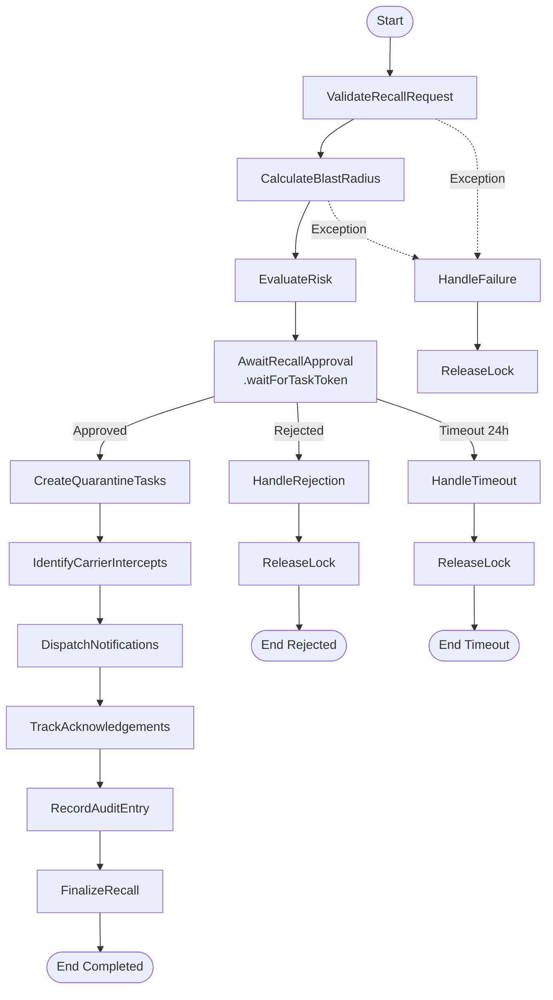

# BatchGuard — AWS Serverless Technical Evidence

> [!IMPORTANT]
> **Implementation & Local Validation Evidence Disclosure:**  
> The artifacts, logs, schemas, and inventories presented in this document represent **verified source code implementations and local testing evidence** executed against the AWS Serverless Application Model (AWS SAM) specification, `pytest`, and `moto`.  
> They **do not represent live AWS deployment evidence**. Real AWS cloud resource creation on developer account `316636858874` was blocked by an upstream AWS Organizations Service Control Policy (SCP `p-ifuj16mo`).

---

## 1. Backend Test Suite Execution Evidence (pytest)

* **Command:** `pytest backend/tests`
* **Test Runner:** pytest 9.2.0 (Python 3.12.10, pluggy 1.7.0, anyio 4.15.1, asyncio 1.4.1, moto)
* **Status:** **108 / 108 Passed (100% Pass Rate)**
* **Execution Duration:** 1.37 seconds

### Test File Breakdown

| Test File | Test Cases | Scope Covered | Status |
| :--- | :---: | :--- | :---: |
| `backend/tests/test_batch_service.py` | 4 | Batch registration, GTIN validation, query pagination | **PASSED** |
| `backend/tests/test_db_serialization.py` | 2 | DynamoDB type conversions, decimal rounding, null handling | **PASSED** |
| `backend/tests/test_deployment_remediation.py` | 8 | Pre-deployment environment checks, IAM least-privilege contracts | **PASSED** |
| `backend/tests/test_evidence_and_audit.py` | 18 | Pre-signed S3 URL generation, SHA-256 hash chain verification | **PASSED** |
| `backend/tests/test_handlers.py` | 7 | HTTP API Gateway event adapters, status codes, CORS headers | **PASSED** |
| `backend/tests/test_recall_orchestration.py` | 25 | Step Functions task worker transitions, 2FA tokens, lock release | **PASSED** |
| `backend/tests/test_recall_service.py` | 3 | Blast radius calculation, node grouping, carrier intercepts | **PASSED** |
| `backend/tests/test_response.py` | 2 | Standard API JSON response envelope formatting | **PASSED** |
| `backend/tests/test_schemas.py` | 5 | Pydantic payload validation, required attributes, type enforcement | **PASSED** |
| `backend/tests/test_security_audit.py` | 20 | Role-based authorization, JWT verification, sanitization | **PASSED** |
| `backend/tests/test_supplier_service.py` | 2 | Supplier enrollment, GLN validation, tier classification | **PASSED** |
| `backend/tests/test_traceability_engine.py` | 12 | BFS backward traversal, cycle detection, KDE confidence math | **PASSED** |
| **Total** | **108** | **Full Serverless Backend Logic & Invariant Validation** | **108 Passed** |

---

## 2. Infrastructure as Code Validation Evidence (AWS SAM)

* **Command:** `sam validate --lint`
* **Target File:** `template.yaml`
* **Result:** `D:\BatchGuard\template.yaml is a valid SAM Template`
* **Errors:** 0
* **Warnings:** 0

---

## 3. Complete AWS Lambda Function Inventory (20 Functions)

All 20 functions are defined in `template.yaml` using Python 3.12 on ARM64 architecture (`arm64` Graviton2) with structured CloudWatch logging:

### A. HTTP API Handlers (7 Functions)

| Resource Logical ID | Handler Function | Runtime | Memory | Timeout | Routes Bound |
| :--- | :--- | :---: | :---: | :---: | :--- |
| `BatchFunction` | `backend/handlers/batches/handler.lambda_handler` | Python 3.12 | 256 MB | 10s | `GET/POST /v1/batches`, `GET /v1/batches/{id}`, `GET /v1/batches/{id}/lineage`, `GET /v1/batches/{id}/traceability` |
| `RecallFunction` | `backend/handlers/recalls/handler.lambda_handler` | Python 3.12 | 512 MB | 15s | `POST /v1/recalls/initiate`, `POST /v1/recalls/assess-blast-radius`, `GET /v1/recalls`, `GET /v1/recalls/{id}`, `POST /v1/recalls/{id}/acknowledge`, `POST /v1/recalls/{id}/approve`, `POST /v1/recalls/{id}/reject`, `GET /v1/recalls/{id}/status`, `GET /v1/recalls/{id}/quarantine-tasks`, `GET /v1/recalls/{id}/acknowledgement-summary` |
| `OverviewFunction` | `backend/handlers/overview/handler.lambda_handler` | Python 3.12 | 256 MB | 10s | `GET /v1/overview/summary` |
| `SupplierFunction` | `backend/handlers/suppliers/handler.lambda_handler` | Python 3.12 | 256 MB | 10s | `GET/POST /v1/suppliers`, `GET /v1/suppliers/{id}` |
| `DistributionFunction` | `backend/handlers/distribution/handler.lambda_handler` | Python 3.12 | 256 MB | 10s | `GET/POST /v1/distribution/nodes`, `GET /v1/distribution`, `GET /v1/distribution/nodes/{id}` |
| `EvidenceFunction` | `backend/handlers/evidence/handler.lambda_handler` | Python 3.12 | 256 MB | 15s | `POST /v1/evidence/presigned-url`, `GET /v1/evidence`, `GET /v1/evidence/{id}/download-url` |
| `AuditFunction` | `backend/handlers/audit/handler.lambda_handler` | Python 3.12 | 256 MB | 10s | `GET/POST /v1/audit/logs` |

### B. Step Functions Task Workers (13 Functions)

| Resource Logical ID | Handler Function | Runtime | Memory | Timeout | Step Functions State |
| :--- | :--- | :---: | :---: | :---: | :--- |
| `ValidateRecallRequestWorker` | `backend/workers/validate_recall_request.lambda_handler` | Python 3.12 | 256 MB | 30s | `ValidateRecallRequest` |
| `CalculateBlastRadiusWorker` | `backend/workers/calculate_blast_radius.lambda_handler` | Python 3.12 | 512 MB | 60s | `CalculateBlastRadius` |
| `EvaluateRecallRiskWorker` | `backend/workers/evaluate_recall_risk.lambda_handler` | Python 3.12 | 256 MB | 30s | `EvaluateRisk` |
| `AwaitApprovalWorker` | `backend/workers/await_approval.lambda_handler` | Python 3.12 | 256 MB | 30s | `AwaitRecallApproval` (`.waitForTaskToken`) |
| `CreateQuarantineTasksWorker` | `backend/workers/create_quarantine_tasks.lambda_handler` | Python 3.12 | 256 MB | 30s | `CreateQuarantineTasks` |
| `IdentifyCarrierInterceptsWorker` | `backend/workers/identify_carrier_intercepts.lambda_handler` | Python 3.12 | 256 MB | 30s | `IdentifyCarrierIntercepts` |
| `DispatchNotificationsWorker` | `backend/workers/dispatch_notifications.lambda_handler` | Python 3.12 | 256 MB | 30s | `DispatchNotifications` |
| `TrackAcknowledgementsWorker` | `backend/workers/track_acknowledgements.lambda_handler` | Python 3.12 | 256 MB | 30s | `TrackAcknowledgements` |
| `RecordAuditEntryWorker` | `backend/workers/record_audit_entry.lambda_handler` | Python 3.12 | 256 MB | 30s | `RecordAuditEntry` |
| `FinalizeRecallWorker` | `backend/workers/finalize_recall.lambda_handler` | Python 3.12 | 256 MB | 30s | `FinalizeRecall` |
| `HandleRejectionWorker` | `backend/workers/handle_rejection.lambda_handler` | Python 3.12 | 256 MB | 30s | `HandleRejection` |
| `HandleTimeoutWorker` | `backend/workers/handle_timeout.lambda_handler` | Python 3.12 | 256 MB | 30s | `HandleTimeout` |
| `HandleFailureWorker` | `backend/workers/handle_failure.lambda_handler` | Python 3.12 | 256 MB | 30s | `HandleFailure` |

---

## 4. Step Functions Workflow Definition Evidence

* **State Machine Logical ID:** `RecallOrchestratorStateMachine`
* **Definition File:** `statemachine/recall_orchestrator.asl.json`
* **Workflow Type:** Standard Workflow
* **Execution Pattern:** State machine halts at human approval gate using `.waitForTaskToken`, requiring Compliance Officer sign-off with 2FA token before broadcasting.



---

## 5. Amazon DynamoDB Architecture Evidence

* **Primary Table:** `BatchGuard-Main-${Environment}`
* **Billing Mode:** `PAY_PER_REQUEST` (On-Demand Capacity)
* **Partition Key (PK):** `String`
* **Sort Key (SK):** `String`
* **Global Secondary Indexes:**
  * **GSI1:** `GSI1PK` (Partition) / `GSI1SK` (Sort) — Reverse lookups and status queries
  * **GSI2:** `GSI2PK` (Partition) / `GSI2SK` (Sort) — Audit and actor lookups
* **Security & Resilience:** Server-Side Encryption (`KMS`), Point-in-Time Recovery (`PITR`) enabled.

### Single-Table Entity Mapping Matrix

| Entity | PK | SK | GSI1PK | GSI1SK | Description |
| :--- | :--- | :--- | :--- | :--- | :--- |
| **Organization** | `ORG#<orgId>` | `METADATA` | `TYPE#ORG` | `<name>` | Multi-tenant organization profile |
| **Supplier** | `ORG#<orgId>` | `SUPPLIER#<id>` | `TYPE#SUPPLIER` | `<status>#<name>` | Grower, farm, or processor record |
| **Product** | `ORG#<orgId>` | `PRODUCT#<gtin>` | `TYPE#PRODUCT` | `<sku>` | Finished goods SKU catalog |
| **Batch** | `ORG#<orgId>` | `BATCH#<id>` | `GTIN#<gtin>` | `BATCH#<timestamp>` | Production lot record with telemetry |
| **Lineage Event** | `BATCH#<id>` | `EVENT#<id>` | `TYPE#EVENT` | `<timestamp>` | Critical tracking event / harvest link |
| **Distribution Node** | `ORG#<orgId>` | `NODE#<id>` | `TYPE#NODE` | `<type>#<name>` | DC, Carrier fleet, or Retail store |
| **Allocation Record** | `BATCH#<id>` | `DIST#<nodeId>` | `NODE#<nodeId>` | `BATCH#<id>` | Pallet consignment distribution |
| **Recall Incident** | `ORG#<orgId>` | `RECALL#<id>` | `BATCH#<id>` | `STATUS#<status>` | Targeted recall workflow state |
| **Active Lock** | `ORG#<orgId>` | `ACTIVE_RECALL#<batchId>` | `STATUS#ACTIVE` | `<timestamp>` | Atomic mutual exclusion lock |
| **Acknowledgement** | `RECALL#<id>` | `ACK#<nodeId>` | `NODE#<nodeId>` | `ACK#<timestamp>` | Facility physical quarantine sign-off |
| **Audit Ledger** | `ORG#<orgId>` | `AUDIT#<ts>#<id>` | `USER#<userId>` | `AUDIT#<ts>` | Append-only SHA-256 hash block |

---

## 6. Amazon API Gateway Route Specifications (24 Routes)

* **Gateway:** Amazon API Gateway HTTP API v2 (`BatchGuardApi`)
* **Authorizer:** Amazon Cognito User Pool JWT Authorizer (`BatchGuardUserPoolAuthorizer`)
* **Standard Response Envelope:** `{ success: boolean, data: any, error: any, meta: { requestId, timestamp } }`

```
GET    /v1/overview/summary
GET    /v1/batches
POST   /v1/batches
GET    /v1/batches/{batchId}
GET    /v1/batches/{batchId}/lineage
GET    /v1/batches/{batchId}/traceability
POST   /v1/recalls/initiate
POST   /v1/recalls/assess-blast-radius
GET    /v1/recalls
GET    /v1/recalls/{recallId}
POST   /v1/recalls/{recallId}/acknowledge
GET    /v1/recalls/{recallId}/acknowledgements
POST   /v1/recalls/{recallId}/approve
POST   /v1/recalls/{recallId}/reject
GET    /v1/recalls/{recallId}/status
GET    /v1/recalls/{recallId}/quarantine-tasks
GET    /v1/recalls/{recallId}/acknowledgement-summary
GET    /v1/suppliers
POST   /v1/suppliers
GET    /v1/suppliers/{supplierId}
GET    /v1/distribution
GET    /v1/distribution/nodes
POST   /v1/distribution/nodes
GET    /v1/distribution/nodes/{nodeId}
POST   /v1/evidence/presigned-url
GET    /v1/evidence
GET    /v1/evidence/{docId}/download-url
GET    /v1/audit/logs
POST   /v1/audit/logs
```

