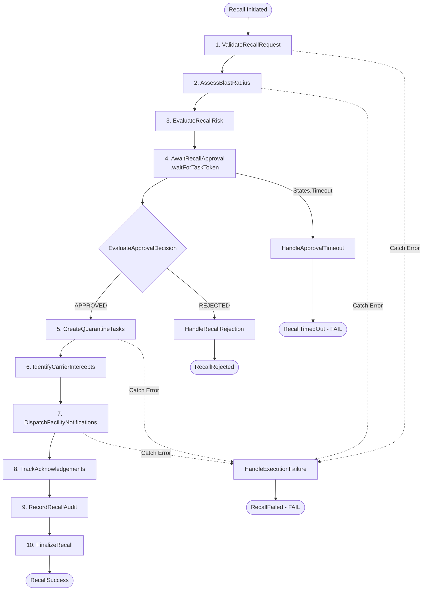

# BatchGuard Serverless Recall Orchestration Architecture

> **Engineering Reference Document**
> Specification for AWS Step Functions recall orchestration, human approval gates, state transitions, Lambda workers, and DynamoDB single-table entity patterns.

---

## 1. Orchestration Overview

The **One-Click Recall Orchestrator** is BatchGuard's signature enterprise capability. When a severe food safety incident is confirmed (e.g. pathogenic *Listeria monocytogenes* or *E. coli* O157:H7 detection), the system transitions from passive traceability to targeted operational containment.

To provide fault tolerance, end-to-end auditability, and non-blocking asynchronous execution, the workflow is orchestrated using **AWS Step Functions Standard Workflows** (`statemachine/recall_orchestrator.asl.json`).

### Key Invariants:
1. **No Unilateral Irreversible Actions:** Emergency broadcasts and warehouse locks require formal Human Approval Gate sign-off by an authorized Compliance Officer (`COMPLIANCE_OFFICER` or `ADMIN` role).
2. **Sub-Second Concurrency Control:** Simultaneous recall attempts on the same batch are blocked via atomic conditional writes (`PK=ORG#<orgId>, SK=ACTIVE_RECALL#<batchId>`).
3. **Approval Timeout Guard:** An expired approval window (default 24h) **never automatically approves a recall**; the workflow safely transitions to `FAILED` with status reason `APPROVAL_WINDOW_EXPIRED`.
4. **Tenant Isolation:** All recall state transitions, quarantine tasks, and partner notifications strictly enforce organization boundaries derived from trusted Amazon Cognito JWT claims.

---

## 2. State Machine Architecture (ASL Workflow)



---

## 3. Operational State Transition Model

BatchGuard implements an explicit state machine model across 12 discrete operational statuses:

| Status | Category | Description | Valid Next Transitions |
| :--- | :---: | :--- | :--- |
| `DRAFT` | Preparatory | Recall incident initiated in sandbox or draft mode | `ASSESSING`, `CANCELLED` |
| `ASSESSING` | Intelligence | Blast radius computation and risk evaluation underway | `PENDING_APPROVAL`, `FAILED`, `CANCELLED` |
| `INITIATED` | Operational | Incident initiated; awaiting transition to approval | `PENDING_APPROVAL`, `APPROVED`, `FAILED`, `CANCELLED` |
| `PENDING_APPROVAL` | Gate | Paused in Step Functions waiting for authorized human sign-off | `APPROVED`, `REJECTED`, `FAILED`, `CANCELLED` |
| `APPROVED` | Transition | Authorized by Compliance Officer; resuming Step Functions | `EXECUTING`, `FAILED`, `CANCELLED` |
| `REJECTED` | Terminal | Aborted by human reviewer; lock released | *None (Terminal)* |
| `EXECUTING` | Active | Creating quarantine tasks & evaluating carrier intercepts | `NOTIFICATION_DISPATCHED`, `FAILED`, `CANCELLED` |
| `NOTIFICATION_DISPATCHED` | Active | Emergency SNS broadcast and EDI 940 hold payloads sent | `AWAITING_ACKNOWLEDGEMENTS`, `FAILED` |
| `AWAITING_ACKNOWLEDGEMENTS` | Monitoring | Waiting for partner facility docks to acknowledge quarantine | `PARTIALLY_ACKNOWLEDGED`, `COMPLETED`, `FAILED` |
| `PARTIALLY_ACKNOWLEDGED` | Monitoring | At least one facility confirmed hold, others pending | `COMPLETED`, `FAILED` |
| `COMPLETED` | Terminal | 100% of affected inventory accounted for and secured | *None (Terminal)* |
| `FAILED` | Terminal | Workflow failure, timeout, or service error; lock released | *None (Terminal)* |
| `CANCELLED` | Terminal | Manually cancelled by administrator | *None (Terminal)* |

---

## 4. Human Approval Mechanism (Callback Pattern)

### 4.1 Step Functions Callback (`.waitForTaskToken`)
In `statemachine/recall_orchestrator.asl.json`, the state `AwaitRecallApproval` uses:
```json
"Resource": "arn:aws:states:::lambda:invoke.waitForTaskToken",
"Parameters": {
  "FunctionName": "${AwaitApprovalFunctionArn}",
  "Payload": {
    "recallId.$": "$.recallId",
    "batchId.$": "$.batchId",
    "orgId.$": "$.orgId",
    "taskToken.$": "$$.Task.Token"
  }
},
"TimeoutSeconds": 86400
```
* **Token Persistence:** The `AwaitApprovalWorker` stores the `taskToken` in the DynamoDB recall record (`stepFunctionsTaskToken`).
* **Resumption:** When the authorized officer calls `POST /v1/recalls/{recallId}/approve`, the backend executes `sfn.send_task_success(taskToken=task_token, output=...)`.
* **Rejection:** When `POST /v1/recalls/{recallId}/reject` is invoked, `sfn.send_task_success` passes `approvalDecision: "REJECTED"`, routing the workflow to `HandleRecallRejection`.

---

## 5. Lambda Worker Responsibilities

All workers in `backend/workers/` follow the Single Responsibility Principle:

1. **`validate_recall_request.py`:** Validates batch existence and verifies tenant ownership.
2. **`calculate_blast_radius.py`:** Executes Stage 6 `TraceabilityEngine` for blast radius evaluation and inventory snapshots.
3. **`evaluate_recall_risk.py`:** Evaluates risk classification (`CRITICAL`, `HIGH`), carrier intercept needs, and POS scan-block requirements.
4. **`await_approval.py`:** Receives `taskToken` from Step Functions, writes it to DynamoDB, and sets status to `PENDING_APPROVAL`.
5. **`create_quarantine_tasks.py`:** Creates discrete facility records (`TASK#QUARANTINE#<nodeId>`).
6. **`identify_carrier_intercepts.py`:** Flags in-transit line-haul carriers for physical dock re-routing.
7. **`dispatch_notifications.py`:** Publishes broadcast alerts to Amazon SNS and records dispatch ledger.
8. **`track_acknowledgements.py`:** Computes initial facility sign-off rates.
9. **`record_audit_entry.py`:** Writes immutable SHA-256 cryptographically signed audit log.
10. **`finalize_recall.py`:** Updates recall status to `AWAITING_ACKNOWLEDGEMENTS` with timestamps.
11. **`handle_rejection.py`:** Marks status `REJECTED`, records rejection audit, and releases lock.
12. **`handle_timeout.py`:** Marks status `FAILED`, records timeout audit, and releases lock.
13. **`handle_failure.py`:** Catches all task errors, records failure audit, and releases lock.

---

## 6. DynamoDB Single-Table Schema Additions

Stage 7 introduces the following entity keys into `BatchGuard-Main-{Environment}`:

| Entity | PK | SK | Purpose |
| :--- | :--- | :--- | :--- |
| **Active Recall Lock** | `ORG#<orgId>` | `ACTIVE_RECALL#<batchId>` | Atomic mutex preventing concurrent recalls on same batch |
| **Quarantine Task** | `RECALL#<recallId>` | `TASK#QUARANTINE#<nodeId>` | Discrete facility quarantine instructions and verification |
| **Carrier Intercept** | `RECALL#<recallId>` | `INTERCEPT#<nodeId>` | High-priority transit re-routing directive |
| **Notification Dispatch** | `RECALL#<recallId>` | `NOTIFICATION#<ts>#<id>` | Immutable dispatch proof with SNS message ID |

---

## 7. Security & Compliance Summary

1. **Cognito Claims Validation:** Caller identity (`auth.org_id`, `auth.user_email`, `auth.roles`) is extracted from verified authorizer claims, blocking tenant spoofing.
2. **Server-Side RBAC:** Approving or rejecting recalls requires explicit `COMPLIANCE_OFFICER` or `ADMIN` roles verified server-side.
3. **Audit Immutability:** All approval, rejection, notification, and quarantine transitions are appended to the audit ledger with SHA-256 integrity digests.
