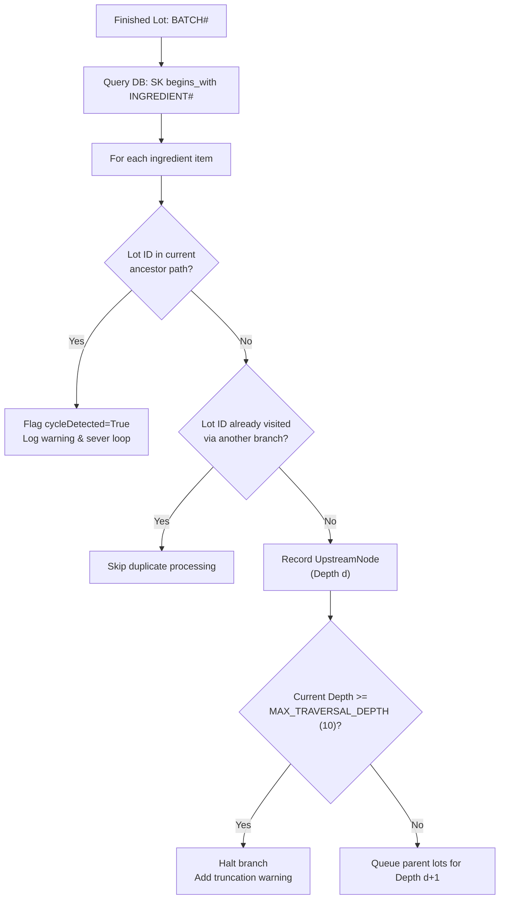

# BatchGuard Traceability Intelligence Engine Specification

> **Engineering Reference Document**
> Architecture, traversal algorithms, data models, confidence scoring, and recall impact calculation for the BatchGuard Traceability Intelligence Engine.

---

## 1. Engine Overview

The **BatchGuard Traceability Intelligence Engine** (`backend/services/traceability_engine.py`) is the core computational service responsible for:
1. **Multi-level Backward Ingredient Traversal:** Reconstructing raw ingredient provenance across agricultural suppliers, intermediate processed batches, and seed lots.
2. **Forward Distribution Tracking:** Tracing downstream finished goods through transit carriers, primary and regional distribution centers (DCs), and retail points of sale.
3. **Facility Deduplication & Allocation Aggregation:** Unifying multiple consignments to the same physical node into consolidated inventory states.
4. **Traceability Completeness & Confidence Scoring:** Computing an objective 0–100% confidence metric based on six weighted Key Data Element (KDE) dimensions.
5. **Recall Blast Radius Assessment:** Calculating physical unit quarantine requirements, isolating affected facilities, and quantifying unconfirmed inventory risk without masking data gaps.

---

## 2. Backward Lineage Traversal Algorithm

### 2.1 Breadth-First Traversal with Cycle Severing
Backward ingredient tracing uses a breadth-first search (BFS) queue to navigate upstream lot dependencies stored under the DynamoDB single-table pattern (`PK=BATCH#<batchId>`, `SK=INGREDIENT#<rawLotId>`).

### 2.2 Algorithm Invariants
* **Maximum Traversal Depth:** Capped at `MAX_TRAVERSAL_DEPTH = 10` levels to prevent run-away queries or unbounded stack depth.
* **Path-Based Cycle Detection:** Each queue element tracks its specific ancestor path `path: List[str]`. If `raw_lot_id in path`, the cycle is detected, `cycleDetected` is flagged `True`, a structured audit warning is emitted, and the branch is severed.
* **Global Visited Set:** `visited_lot_ids: Set[str]` prevents exponential re-exploration of diamond dependencies (e.g., two distinct intermediate components sourcing from the same raw spinach harvest lot).
* **Missing Parent Handling:** If an ingredient lot specifies upstream parents that do not exist in the database, the missing lot ID is flagged in `missingRecords` without failing the overall lineage query.

---

## 3. Forward Distribution Tracking & Facility Deduplication

### 3.1 Downstream Traversal
Forward distribution tracking queries physical shipments assigned to the batch (`PK=BATCH#<batchId>`, `SK=DIST#<nodeId>`).

### 3.2 Facility Deduplication & Inventory State Ledger
When a facility receives multiple distinct consignments of the same production lot over time, the engine aggregates them into a unified `DownstreamFacilityNode`:

$$\text{shippedUnits}_{\text{total}} = \sum \text{shippedUnits}_{i}$$
$$\text{receivedUnits}_{\text{total}} = \sum \text{receivedUnits}_{i}$$
$$\text{soldUnits}_{\text{total}} = \sum \text{soldUnits}_{i}$$
$$\text{remainingUnits}_{\text{total}} = \sum \text{remainingUnits}_{i}$$
$$\text{quarantinedUnits}_{\text{total}} = \sum \text{quarantinedUnits}_{i}$$

### 3.3 Physical Inventory State Classification
Every unit is categorized into one of six distinct physical states:
1. **Shipped / In-Transit:** Consigned to carrier or node; difference between shipped and received quantities.
2. **Received:** Formally acknowledged and scanned at receiving dock.
3. **Quarantined / On-Hold:** Scanned and placed in physical hold under active recall order.
4. **Available Remaining:** On warehouse racks or store shelves available for purchase.
5. **Sold:** Registered as sold through POS transaction logs.
6. **Unknown / Unconfirmed:** Discrepancy where units are neither accounted for in physical remaining inventory nor recorded as sold.

> [!IMPORTANT]
> The engine **never interprets missing or unconfirmed inventory as zero**. Discrepancies between total batch quantity and accounted-for distribution are flagged explicitly in `unconfirmedUnits` to prevent false safety assurances during recalls.

---

## 4. Traceability Completeness & Confidence Scoring

The Traceability Confidence metric assesses data hygiene and readiness across 6 weighted dimensions based on FDA FSMA 204 Key Data Elements (KDEs):

| Dimension | Weight | Criteria & Evaluation Rules |
| :--- | :---: | :--- |
| **Origin & Harvest** | 20% | Raw agricultural origin verification, harvest timestamp presence, farm coordinates/GLN. |
| **Supplier Verification** | 15% | Supplier ID verified, non-empty partner status, known certification. |
| **Lab & Evidence** | 20% | Microbial lab test (E. coli / Listeria / Salmonella), pesticide screen, Certificate of Analysis (COA) attached. |
| **Chain of Custody** | 15% | Distribution records present, GLN populated for every node, transit carrier logs recorded. |
| **Downstream Delivery** | 15% | Delivery timestamps confirmed, receiving acknowledgements signed off. |
| **POS & Unit Balance** | 15% | Mass balance conservation: $|(\text{remaining} + \text{sold} + \text{in-transit}) - \text{initial}| \le \epsilon$. Negative inventory incurs severe penalty. |

### 4.1 Penalties & Structural Deductions
* **Cycle Detected:** $-15\%$ deduction if a circular ingredient loop is detected.
* **Unverified Supplier Origin:** $-10\%$ deduction per unverified or unmapped raw lot.
* **Negative Inventory Anomaly:** $-25\%$ deduction if any facility reports negative remaining or sold stock.
* **Classification Scale:**
  * **90% – 100%:** `HIGH` confidence (Audit-ready, FSMA 204 aligned).
  * **70% – 89%:** `MEDIUM` confidence (Traceable, minor KDE gaps).
  * **0% – 69%:** `LOW` confidence (Critical telemetry or chain-of-custody gaps).

---

## 5. Recall Impact Assessment & Blast Radius

The recall impact engine computes targeted operational isolation metrics:
* **Impacted Facilities Count:** Unique physical distribution centers and retail stores with positive remaining inventory.
* **Estimated Units at Risk:** $\text{Initial Units} - \text{Sold Units}$ (total units not confirmed consumed).
* **Physical Quarantine Target:** Actual units physically sitting in warehouse and retail bins requiring quarantine lock:
  $$\text{Units to Quarantine} = \sum_{n \in \text{Facilities}} \text{remainingUnits}_n$$
* **Unconfirmed Units:** Potential shrinkage, in-transit discrepancy, or unreported stock:
  $$\text{Unconfirmed Units} = \max(0, \text{Total Batch Units} - (\text{Known Remaining} + \text{Confirmed Sold}))$$
* **Carrier Intercepts Required:** Active line-haul or LTL transit shipments that must be halted before dock delivery.

---

## 6. API Ingress & Pagination

### Endpoints:
* `GET /v1/batches/{batchId}/traceability`
  * Query parameters: `includeLineage=true`, `limit=50`, `nextToken=<base64>`
  * Returns: `FullTraceabilityGraph` including upstream nodes, downstream nodes, completeness score, and impact metrics.
* `POST /v1/recalls/assess-blast-radius`
  * Request payload: `{"batchId": "BG-2026-0891", "hazardClassification": "CLASS_I"}`
  * Returns: `BlastRadiusAssessment` with impacted facilities list, unconfirmed unit risks, and required carrier intercepts.

### Pagination Pattern:
For large distribution networks (e.g., > 100 retail outlets), the downstream lineage query supports DynamoDB pagination via standard `ExclusiveStartKey` base64 serialization, returning a `nextToken` for cursor resumption.
